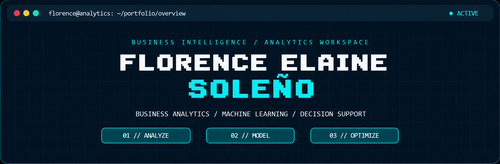
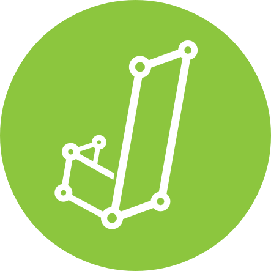

 

  

---

<h2 align="left">
  
</h2>

<table width="200%">
<tr>

<!-- LEFT: INTRODUCTION -->
<td width="65%" valign="top">

<h3>Hi, I'm Florence 👋</h3>

I'm a fourth-year <b>BS Information Systems student
majoring in Business Analytics</b> at
<b>West Visayas State University</b>,
and an <b>aspiring Data Scientist</b>.

I work at the intersection of <b>data, technology,
and business problems</b>—from preparing and
visualizing data to building predictive models
and decision-support systems. I'm especially
interested in projects that turn analytical
findings into practical recommendations.

Currently focused on <b>machine learning,
business intelligence, optimization,</b>
and communicating insights clearly.

</td>

<!-- RIGHT: PHOTO AND ANALYST STATUS -->
<td width="100%" align="left" valign="top">

 

 

 

 

</td>

</tr>
</table>

</td></tr></table>

<!-- ============================================== -->
<!-- 02 // FEATURED PROJECTS -->
<!-- ============================================== -->

<h2 align="left">
  
</h2>

A selection of academic and applied projects in machine learning,
data analytics, optimization, and interactive decision-support systems.

<!-- ============================================== -->
<!-- PROJECT GRID -->
<!-- ============================================== -->

<table width="100%">

<!-- ROW 01 -->
<tr>

<!-- PROJECT 01: TANAW -->
<td width="50%" valign="top">

 

<b>TANAW — Integrated Decision Support System</b>

<b>Optimization · Agricultural Analytics · Systems Development</b>

An integrated decision support system for optimized seed allocation
and monitoring and evaluation under the <b>Masagana Hybrid Rice
Program</b>. Uses Mixed-Integer Linear Programming (MILP) and
lexicographic optimization to support data-driven resource allocation.

</td>

<!-- PROJECT 02: ENVIRONMENTAL DASHBOARD -->
<td width="50%" valign="top">

 

<b>Environmental Vulnerability &amp; Childhood Autism Dashboard</b>

<b>Environmental Analytics · Public Health · Visualization</b>

An interactive dashboard examining green space, road density, 
population density, household income, and childhood autism prevalence across 
California school districts. Explores environmental associations without 
claiming direct causation, supporting informed public health discussions.

</td>

</tr>

<!-- ROW 02 -->
<tr>

<!-- PROJECT 03: AIRFOIL -->
<td width="50%" valign="top">

 

<b>NASA Airfoil Self-Noise Prediction</b>

<b>Machine Learning · Regression · Aeroacoustics</b>

Predicts scaled sound pressure levels using NASA wind-tunnel data.
Compares LASSO, Ridge, Elastic Net, Decision Tree, and Random Forest
regression models.

</td>

<!-- PROJECT 04: CREDIT RISK -->
<td width="50%" valign="top">

 

<b>Corporate Credit Risk Prediction</b>

<b>Financial Analytics · Predictive Modeling</b>

Models corporate credit risk scores using financial and operational
indicators, comparing regularized regression methods and Random
Forest to support consistent risk assessment.

</td>

</tr>

<!-- ROW 03 -->
<tr>

<!-- PROJECT 05: LINEAR PROGRAMMING -->
<td width="50%" valign="top">

 

<b>Linear Programming &amp; Optimization</b>

<b>Operations Research · Mathematical Optimization</b>

Applied linear programming to optimize modern
jeepney fleet assignments across five commuter
routes in Iloilo City. Modeled vehicle allocation
from Jaro, City Proper, and Tagbak depot hubs
to minimize total pre-service travel time
while satisfying route demand and fleet
capacity constraints.

</td>

<!-- PROJECT 06: STUDENT SUCCESS -->
<td width="50%" valign="top">

 

<b>Student Success &amp; Dropout Risk Dashboard</b>

<b>Education Analytics · Interactive Visualization · Student Outcomes</b>

An interactive analytics dashboard exploring academic, demographic, and socioeconomic factors 
associated with student success and dropout risk. Features interactive visualizations and filtering tools 
to identify student performance patterns and explore factors contributing to dropout risk.

</td>

</tr>

</table>

<!-- ============================================== -->
<!-- 03 // ANALYTICS TOOLKIT -->
<!-- ============================================== -->

<h2 align="left">
  
</h2>

<table width="100%" align="center">

<!-- PROGRAMMING & NOTEBOOKS -->
<tr>
<td width="35%">
  
</td>
<td width="65%">
  
  &nbsp;
  
  &nbsp;
  
  &nbsp;
  
  &nbsp;
  
  
</td>
</tr>

<!-- DATA ANALYSIS & MACHINE LEARNING -->
<tr>
<td>
  
</td>
<td>
  
  &nbsp;
  
  &nbsp;
  
  &nbsp;
  
  &nbsp;
  
  &nbsp;
  
  &nbsp;
  
</td>
</tr>

<!-- BUSINESS INTELLIGENCE & VISUALIZATION -->
<tr>
<td>
  
</td>
<td>
  
  &nbsp;
  
  &nbsp;
  
  &nbsp;
  
  &nbsp;
  
  &nbsp;
  
   &nbsp;
  
</td>
</tr>

<!-- DEVELOPMENT & DATABASES -->
<tr>
<td>
  
</td>
<td>
  
  &nbsp;
  
  &nbsp;
  
  &nbsp;
  
  &nbsp;
  
</td>
</tr>

<!-- PRODUCTIVITY & DESIGN -->
<tr>
<td>
  
</td>
<td>
  
   &nbsp;
  
  &nbsp;
  
</td>
</tr>

</table>

<h2 align="left">
  
</h2>

| Experience | Contribution |
|:--|:--|
| **Co-Founder & Chief Marketing Officer — Foreal Solutions** | Working on **AgriChain**, a digital concept for agricultural supply-chain management. |
| **DAP NextGen PH Startup 2025** | **2nd Runner-Up**, with contributions in concept development, pitching, and data analysis. |
| **Chief Technology Officer — AxIS Organization** | Led technical planning and supported media literacy initiatives. |
| **SK Secretary — Barangay Girado-Magsaysay** | Supported youth initiatives, records management, and digital outreach. |
| **AI Fest PH 2026 — SineAI** | Regional finalist; contributed as a prompt engineer. |

<h2 align="left">
  
</h2>

GitHub activity cards are generated by third-party services and may occasionally be unavailable.

<h2 align="left">
  
</h2>

I'm interested in opportunities to **analyze data, build useful systems, and solve real business problems**. Feel free to explore my projects or get in touch.

📫 **Email:** [florencesolenositaca@gmail.com](mailto:florencesolenositaca@gmail.com)  
💻 **GitHub:** [@florenceelainesoleno](https://github.com/florenceelainesoleno)  
📊 **Streamlit:** [My applications](https://share.streamlit.io/user/florenceelainesoleno)

---

**`ANALYZE THE PROBLEM → MODEL THE POSSIBILITIES → INFORM THE DECISION`**

Florence Elaine G. Soleño · Business Analytics & Data Science Portfolio · 2026

